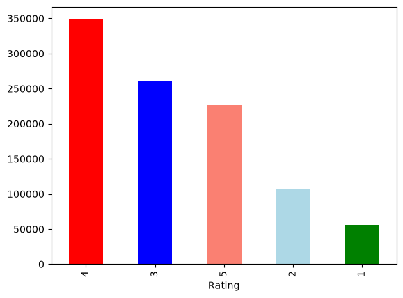

# Deep Learning Movie Recommendation System


[](LICENSE)

An embeddings-based collaborative filtering recommender built with PyTorch. The model learns a vector for every user and every movie from about 1 million [MovieLens 1M](https://grouplens.org/datasets/movielens/1m/) ratings, passes the pair through a deep feed-forward network, and predicts the rating (1 to 5) a user would give a movie they haven't seen.

## Table of Contents

- [Overview](#overview)
- [Dataset](#dataset)
- [Model Architecture](#model-architecture)
- [Results](#results)
- [Tech Stack](#tech-stack)
- [Installation](#installation)
- [Usage](#usage)
- [Configuration](#configuration)
- [Project Structure](#project-structure)
- [Known Issues & Limitations](#known-issues--limitations)
- [Roadmap](#roadmap)
- [Contributing](#contributing)
- [License](#license)
- [Author & Support](#author--support)
- [Acknowledgments](#acknowledgments)

## Overview

Collaborative filtering predicts how a user will react to an item from the reactions of similar users. Imagine a table with users as rows and movies as columns, mostly empty because nobody has rated everything. This project trains a neural network to infer similarities in users' rating patterns and "fill the gaps" in that table.

The notebook walks through the whole pipeline:

1. Download and load the MovieLens 1M data
2. Exploratory data analysis (ratings and movies)
3. Index users and movies, then split into train and validation sets (80/20)
4. Define an embedding network, a cosine-annealed cyclical learning rate, and a training loop with early stopping
5. Evaluate rating accuracy (RMSE) and top-10 ranking quality (Recall@10, NDCG@10) against simple baselines
6. Save the best weights

## Dataset

[MovieLens 1M](https://grouplens.org/datasets/movielens/1m/) from GroupLens Research.

| | Count |
|---|---|
| Ratings | 1,000,209 |
| Users | 6,040 |
| Movies rated | 3,706 (of 3,883 in the movie file) |
| Rating scale | 1 to 5 (whole stars) |

There are no missing values in the ratings or movie files. The most common rating is 4 (348,971 ratings), followed by 3 and 5.



## Model Architecture

`EmbeddingNet` is a configurable `nn.Module`:

```text
user id  -> Embedding(num_users, 150)  ─┐
                                        ├─ concat -> Dropout(0.1)
movie id -> Embedding(num_movies, 150) ─┘
        -> [Linear -> ReLU -> Dropout] x hidden layers (500, 500, 500; dropouts 0.2, 0.4)
        -> Linear(500, 1) -> Sigmoid -> scaled to the 1-5 rating range
```

Training setup used in the notebook:

| Setting | Value |
|---|---|
| Loss | Mean squared error |
| Optimizer | Adam (learning rate 1e-3, weight decay 1e-5) |
| LR schedule | Cosine annealing with restarts (`CyclicLR`, 2-epoch cycles) |
| Batch size | 2,000 |
| Max epochs / patience | 100 / 10 (early stopping) |
| Device | Apple MPS, then CUDA, then CPU (auto-detected) |

## Results

Evaluated on the 20% validation split (200,042 ratings). Training stopped early after epoch 17, and the best weights came from epoch 7 (validation MSE 0.771).

**Rating prediction (RMSE, lower is better)**

| Method | RMSE |
|---|---|
| **EmbeddingNet (this project)** | **0.8781** |
| Movie-mean baseline | 0.9824 |
| Global-mean baseline | 1.1197 |

**Top-10 ranking (higher is better).** Relevant items are validation movies the user rated 4 or higher; movies the user already rated in training are excluded.

| Method | Recall@10 | NDCG@10 |
|---|---|---|
| EmbeddingNet | 0.041 | 0.073 |
| **Popularity baseline** | **0.086** | **0.173** |

The network is clearly better than the mean baselines at predicting ratings, but a simple "recommend the most-rated movies" baseline beats it on top-10 ranking. A model trained to minimize rating error does not automatically produce a good ranked list. See [Roadmap](#roadmap) for ideas to close that gap.

## Tech Stack

- **Language:** Python 3.12+
- **Deep learning:** PyTorch
- **Data:** pandas, NumPy
- **Modeling utilities:** scikit-learn (`train_test_split`)
- **Visualization:** Matplotlib
- **Environment:** Jupyter Notebook

## Installation

```bash
# 1. Clone the repository
git clone https://github.com/vjabarca/DL-Movie-Recommendation-System.git
cd DL-Movie-Recommendation-System

# 2. Create and activate a virtual environment
python -m venv .venv
source .venv/bin/activate        # Windows: .venv\Scripts\activate

# 3. Install dependencies
pip install torch pandas numpy matplotlib scikit-learn jupyter

# 4. Launch the notebook
jupyter notebook Movie_Recommendation_System.ipynb
```

> **Python version:** the training loop uses f-strings that reuse the same quote type inside the braces, which requires Python 3.12 or newer.

## Usage

1. Open `Movie_Recommendation_System.ipynb` and run the cells top to bottom.
2. **Get the data.** The notebook's `download_dataset()` helper opens the dataset link in your browser, waits 5 seconds, then looks for `ml-1m.zip` in the folder set by `download_path`. Set that variable to your own Downloads folder first, or download the file manually from [grouplens.org](https://files.grouplens.org/datasets/movielens/ml-1m.zip) and unzip it so a `ml-1m/` folder sits next to the notebook.
3. Run the preparation, model, and training cells. Training prints train and validation loss each epoch and stops early when validation loss stops improving.
4. Run the metrics cells to see RMSE and the Recall@10 / NDCG@10 comparison.
5. The final cell saves the best weights to `best.weights`.

### Recommending movies for a user

A short snippet built from the notebook's own objects (`model_scores`, `train_seen`, `user2idx`, `movie2idx`, `movies`) that returns the top 10 unseen movies for a user:

```python
idx2movie = {i: m for m, i in movie2idx.items()}

user_id = 1                          # a MovieLens UserID
u = user2idx[user_id]
scores = model_scores(u)
scores[list(train_seen.get(u, set()))] = -np.inf   # hide movies already rated

top = np.argsort(-scores)[:10]
top_ids = [idx2movie[i] for i in top]
print(movies.set_index("MovieID").loc[top_ids, "Title"])
```

## Configuration

Key settings are plain variables in the notebook. Common ones to change:

| Variable | Default | Purpose |
|---|---|---|
| `download_path` | `/Users/vabarca/Downloads` | Where your browser saves `ml-1m.zip` |
| `num_factors` | 150 | Embedding size per user and movie |
| `hidden` / `dropouts` | `[500, 500, 500]` / `[0.2, 0.4]` | Network depth, width, and regularization |
| `learn_rate`, `weight_decay` | 1e-3, 1e-5 | Adam settings |
| `batch_size` | 2000 | Training batch size |
| `patience` | 10 | Epochs without improvement before stopping |
| `K` | 10 | Cutoff for Recall@K and NDCG@K |

No API keys are required.

## Project Structure

```text
.
├── Movie_Recommendation_System.ipynb   # data prep, model, training, evaluation
├── docs/
│   └── rating_distribution.png         # ratings histogram from the EDA
├── LICENSE
└── README.md
```

Files created when you run the notebook (do not commit them): the extracted `ml-1m/` dataset folder and `best.weights`.

## Known Issues & Limitations

- **Beaten by popularity on ranking:** the model's Recall@10 and NDCG@10 are lower than the simple popularity baseline (see [Results](#results)).
- **Overfitting:** training loss keeps falling after epoch 7 while validation loss rises, so early stopping does most of the work. The large 500-unit layers have far more capacity than this data needs.
- **Machine-specific setup:** the default `download_path` is a macOS path, and the browser-based download step is not portable or unattended.
- **Random split:** ratings are split at random (with a fixed NumPy seed), not by time or by user, so the evaluation is optimistic compared with predicting truly future ratings.
- **No cold start:** only users and movies seen in the data have embeddings, so brand-new users or movies cannot be scored.
- **Batching detail:** the batch iterator uses integer division, so the last partial batch of each epoch is skipped.
- **Scheduler warning:** PyTorch warns that `scheduler.step()` is called before `optimizer.step()`, which skips the first learning rate value.
- **Unused imports:** a few imports (`PCA`, `urlopen`, `URLError`) are not used yet.
- **Pickled weights:** `best.weights` is saved with `pickle`. Only load pickle files you created yourself; `torch.save` is the safer standard.

## Roadmap

- [ ] Download the dataset directly in code so the notebook runs on any machine
- [ ] Add a ranking-oriented training objective (for example BPR or sampled softmax) to improve Recall@10 and NDCG@10
- [ ] Try a smaller network, higher dropout, or larger weight decay to reduce overfitting
- [ ] Add a time-based train/validation split
- [ ] Add user and movie bias terms and compare against matrix factorization
- [ ] Use movie genres as extra features to help with cold start
- [ ] Plot training curves and visualize movie embeddings (PCA is already imported)
- [ ] Add a `requirements.txt` with pinned versions
- [ ] Wrap the best model in a small demo (CLI or web app)

## Contributing

Contributions, bug reports, and feature ideas are welcome.

1. **Report a bug or request a feature:** open an [issue](https://github.com/vjabarca/DL-Movie-Recommendation-System/issues) and include what you expected, what happened, and your environment (OS, Python and PyTorch versions).
2. **Submit a change:**
   1. Fork the repository
   2. Create a branch: `git checkout -b feature/your-feature`
   3. Commit your changes with a clear message
   4. Push the branch and open a pull request describing what changed and why

Please clear notebook outputs (or keep them small) before committing.

## License

Distributed under the MIT License. See [`LICENSE`](LICENSE) for details. The MovieLens dataset is **not** covered by this license and has its own terms; see below.

## Author & Support

**Victor J. Abarca**, San José, CA

- GitHub: [@vjabarca](https://github.com/vjabarca)

For questions or problems, please open an issue in this repository.

## Acknowledgments

- [GroupLens Research](https://grouplens.org/) for the MovieLens dataset. Per their terms, the data is for non-commercial research use and is not redistributed in this repository. Citation: F. Maxwell Harper and Joseph A. Konstan. 2015. The MovieLens Datasets: History and Context. *ACM Transactions on Interactive Intelligent Systems* 5(4), Article 19.
- [PyTorch](https://pytorch.org/) for the deep learning framework
